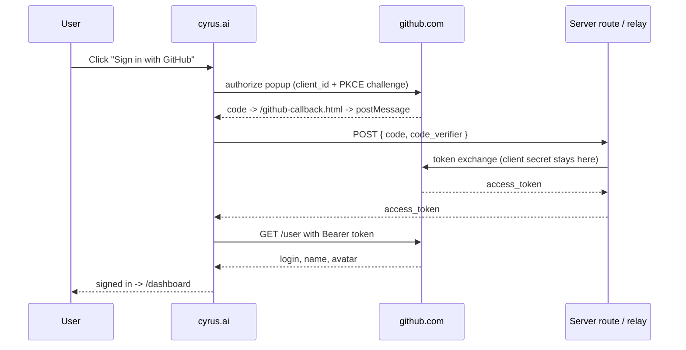
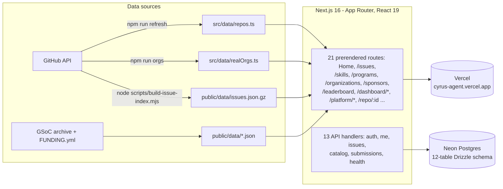

<p align="center">
  
</p>

<h1 align="center">cyrus.ai</h1>

<p align="center">
  <b>The developer-program platform.</b> 1,528 AI-agent repos, 13,539 open-source program projects and 40,017 real open issues - one warm, fast, self-refreshing catalog on Next.js 16 with <b>real OAuth sign-in</b> and a <b>full server backend on Neon Postgres</b>.
</p>

<p align="center">
  <a href="https://cyrus-agent.vercel.app"></a>
  <a href="#-by-the-numbers"></a>
  <a href="#-by-the-numbers"></a>
  <a href="#-by-the-numbers"></a>
  <a href="#-by-the-numbers"></a>
  
</p>

<p align="center">
  
  
  
  
  
  
  
  
</p>

<p align="center">
  <table>
    <tr>
      <td align="center"><b>🚀 Start</b><br/><a href="https://cyrus-agent.vercel.app">Open the site</a><br/><a href="#-quick-start">Run locally</a><br/><a href="#-deploy-on-vercel">Deploy</a></td>
      <td align="center"><b>🧭 Explore</b><br/><a href="https://cyrus-agent.vercel.app/issues">Issue finder</a><br/><a href="https://cyrus-agent.vercel.app/skills">Skills catalog</a><br/><a href="https://cyrus-agent.vercel.app/programs">Programs explorer</a></td>
      <td align="center"><b>🔌 Data &amp; auth</b><br/><a href="#%EF%B8%8F-architecture">Refresh pipeline</a><br/><a href="#-sign-in-actually-real">OAuth design</a><br/><a href="#-see-it-in-action">Screenshot tour</a></td>
    </tr>
  </table>
</p>

---

## 💥 The promise

> **Works like a product, ships like a static site.**

- **One catalog for the whole agent boom** - skills, Cursor rules, AGENTS.md files, MCP servers and dev agents: all 1,528 of them, filterable, with their real GitHub stats, downloadable as JSON.
- **Programs, not guesswork** - 6,682 mentored open-source projects (5,238 GSoC 2022-2026, plus 941 LFX, 437 Outreachy and 66 Summer of Bitcoin) across 402 organizations with thousands of tech tags, plus a page of its own for each of the 13 tracked programs (GSoC, GSSoC, LFX, Outreachy, Eclipse SoC, MLH, Season of KDE, Hacktoberfest, Summer of Bitcoin, Nexus Spring of Code, 24 Pull Requests, FOSSEE Summer Fellowship, Vercel Open Source Program) with their calendars, pay bands and the organizations that took part.
- **40,017 real open issues** - the Issue Finder crawls good-first-issue and help-wanted labels across the catalog with GitHub Search API, then filters by language, label, size and how recently each repo merged a PR.
- **Follow the money** - the Sponsors directory reads `.github/FUNDING.yml` from the top 260 catalog repos by stars and lists the 82 that actually take funding, with the right link to fund each one.
- **Proof over promises** - the PR Leaderboard ranks contributors from merged pull requests on real repos, not self-reported points.
- **A dashboard that works** - saved issues and repositories, plus eight tools built on the same datasets: a season calendar (every program window on one grid, with a prefilled Google Calendar event per window and a whole year as .ics), a demand radar (what five years of accepted projects actually asked for, folded into readable technology groups), a repo analyser (any public repository scored live from GitHub's own community and activity data), a draft studio (README, CONTRIBUTING, LICENSE and CODE_OF_CONDUCT written from your answers, in the browser), a co-pilot matcher (language + interest to repo fits), a mentor finder (over the GSoC archive), an org comparison, and a git-start script generator from any issue URL.
- **Real sign-in** - Google OIDC and GitHub OAuth with PKCE, verified end to end. No fake "demo mode".
- **A real backend, not a mock** - 13 Next.js route handlers with signed-cookie sessions, cross-device saved items, applications, submissions and a catalog query API on Neon Postgres. [The backend](#-the-backend) has the details, including what is switched on by env vars.
- **Static where it should be** - typed JSON snapshots are checked into the repo and regenerated by scripts, so catalog pages prerender and the first paint needs no server round trip.

## 📸 See it in action

Every shot below is the live site, captured at 1440px in the light theme.

<table>
  <tr>
    <td width="50%"></td>
    <td width="50%"></td>
  </tr>
  <tr>
    <td align="center"><b>Home</b> - the editorial hero, a live look at the issue board and the org marquee</td>
    <td align="center"><b>Skills catalog</b> - 1,528 repos with a filter rail, live stats and JSON export</td>
  </tr>
  <tr>
    <td></td>
    <td></td>
  </tr>
  <tr>
    <td align="center"><b>Issue finder</b> - 40,017 real open issues, filtered by label, language and difficulty</td>
    <td align="center"><b>Programs</b> - 13 funded programs with calendars, pay bands and project archives</td>
  </tr>
  <tr>
    <td></td>
    <td></td>
  </tr>
  <tr>
    <td align="center"><b>Organization intel</b> - 43 real GitHub orgs with live stats and GSoC / LFX / MLH badges</td>
    <td align="center"><b>Sponsors directory</b> - the 82 catalog repos that take funding, straight from their FUNDING.yml</td>
  </tr>
  <tr>
    <td></td>
    <td></td>
  </tr>
  <tr>
    <td align="center"><b>Dashboard</b> - signed-in home with saved issues, tracked repos and four working tools</td>
    <td align="center"><b>PR Leaderboard</b> - contributors ranked from merged pull requests on real repos</td>
  </tr>
  <tr>
    <td></td>
    <td></td>
  </tr>
  <tr>
    <td align="center"><b>Dashboard tools</b> - the co-pilot matcher shortlisting repos and live issues</td>
    <td align="center"><b>Project archive</b> - 13,539 mentored projects, filter by year, org and tech</td>
  </tr>
  <tr>
    <td></td>
    <td></td>
  </tr>
  <tr>
    <td align="center"><b>Platform / Features</b> - one of three marketing pages under <code>/platform/*</code></td>
    <td align="center"><b>About</b> - the orbit hero, capability cards and the companies band</td>
  </tr>
</table>

Dark mode is one click away in the header - the same warm palette, roasted.

## 📊 By the numbers

| Section | Size | Source of truth |
|---|---:|---|
| Agent-skills catalog | **1,528 repos** · 33.79M stars · 4.61M forks | GitHub REST via `gh api` |
| Open-source programs | **13,539 projects** · 616 orgs · 3,075 tags | GSoC archive (2016-2026, 12,095) + other programs (LFX 941 / Outreachy 437 / Summer of Bitcoin 66) |
| Good-first issues board | **40,017 open issues** across the catalog | GitHub Search API via `scripts/build-issue-index.mjs` |
| Sponsors directory | **82 funded repos**, found in the top 260 by stars | `.github/FUNDING.yml`, read repo by repo |
| Program deep dives | **13** full program pages, each with its own organization roster | `src/data/programDetails.ts` |
| Organization intel | **43** live org profiles | `scripts/fetch-orgs.mjs` |
| Dashboard tools | 12 screens - overview, issues, repos, season calendar, demand radar, repo analyser, draft studio, matcher, mentors, compare, git-start, settings | the datasets above, in the browser |
| Routes | **21** page routes + 13 API handlers | `src/app/` (App Router) |

### What the catalog is made of

| Category | Repos | Share |
|---|---:|---:|
| Dev tools & agents | 961 | 62.9% |
| Agent skills | 243 | 15.9% |
| MCP servers | 232 | 15.2% |
| AGENTS.md files | 50 | 3.3% |
| Cursor rules | 42 | 2.7% |

## 📈 The catalog at a glance

<p align="center">
  
</p>

<p align="center">
  
</p>

<p align="center">
  
</p>

## 🧭 Inside the platform

- **Splash-to-site in one beat** - an animated orbit splash hands off to the page; catalog pages are prerendered and served from the edge.
- **Light + dark, same soul** - a hand-tuned coffee-and-honey palette with a dainty sun/moon toggle; every token is a CSS variable, so both themes share one source of truth.
- **Living shelves** - counter-drifting marquees for organizations and developer stories, hover to pause, click through to the real profile.
- **Clear section seams** - full-bleed hairline rules divide every marketing section, tuned to stay visible in the light theme.
- **Repo detail that answers questions** - stats, tags, related projects and an honest "why this is here" note on every listing.
- **Self-refreshing data** - `npm run refresh` re-pulls the GSoC archive; `npm run orgs` regenerates org intel from live GitHub; `node scripts/build-issue-index.mjs` re-crawls the issue snapshot. Refresh stamps this README with the newest repository `updated` date in `src/data/repos.ts`, not the refresh date.

## 🗺 Pages

| Route | What it is |
|---|---|
| `/` | Warm editorial home: interactive hero, programs, contribution timeline, org marquee, skills, stories, FAQ |
| `/issues` | Good-first-issue finder over 40,017 real open issues - labels, languages, orgs, difficulty |
| `/organizations` · `/organizations/:login` | 43 real GitHub orgs with live stats and GSoC / LFX / MLH program badges |
| `/leaderboard` | Real contributor rankings from merged pull requests |
| `/projects` | The 13,539-project mentored-program archive (2016-2026 for GSoC, 2022-2026 for the rest), filter by year / org / tech |
| `/programs` · `/programs/:id` | 13 funded programs - calendars, pay bands, who they are for, and their project archives |
| `/skills` | The 1,528-repo agent-skills catalog, filterable and downloadable |
| `/sponsors` | 82 catalog repos that actually take funding, read from their FUNDING.yml |
| `/dashboard` | Signed-in home - saved issues, tracked repos, and the setup checklist |
| `/dashboard/calendar` · `/demand` · `/analyser` · `/drafts` | Season calendar with Google Calendar and .ics export, demand radar over five years of accepted projects, live repo analyser, and the four-file draft studio |
| `/dashboard/matcher` · `/mentors` · `/compare` · `/gitstart` | Co-pilot matcher, mentor finder, org compare, and the git-start script generator |
| `/platform/features` · `/platform/how` · `/platform/trust` | Marketing pages for the platform and the trust centre |
| `/about` | The story, the method and the companies behind the index |
| `/repo/:id` | Repo detail with stats, tags and related projects |
| `/privacy` · `/terms` · `/cookies` · `/affiliations` | The honest legal corner |

## ⚡ Quick start

```bash
git clone https://github.com/adityalenova/cyrus-ai && cd cyrus-ai
npm install
cp .env.example .env        # optional - everything runs with an empty .env too
npm run dev                 # http://localhost:5330
```

```bash
npm run build               # next build (strict tsc runs via npm run check)
npm test                    # vitest: unit + data-integrity suites
npm run check               # tsc --noEmit + next build
npm run refresh             # re-pull the GSoC archive + stamp this README's snapshot date
npm run orgs                # regenerate realOrgs.ts from live GitHub
node scripts/build-issue-index.mjs   # re-crawl the 40k good-first-issue snapshot
npm run gh-relay            # local GitHub token-exchange relay on :8787
npm run db:push && npm run db:seed   # only with a DATABASE_URL (Neon)
```

Environment, all optional - the site degrades gracefully without any of them:

```
# public, shipped to the browser
NEXT_PUBLIC_GOOGLE_CLIENT_ID=...      # Google OAuth web client id
NEXT_PUBLIC_GITHUB_CLIENT_ID=...      # GitHub OAuth app client id
NEXT_PUBLIC_GITHUB_EXCHANGE_URL=...   # relay only if you skip the server routes
NEXT_PUBLIC_TURNSTILE_SITE_KEY=...    # Cloudflare widget key, with the secret below

# server-side, never bundled
DATABASE_URL=...                      # Neon Postgres (pooled)
SESSION_SECRET=...                    # signs the session cookie
GITHUB_CLIENT_SECRET=...              # enables /api/auth/github exchange
RESEND_API_KEY=...                    # email sign-in codes (demo mode without)
EMAIL_FROM=...                        # sender on a domain verified in Resend (required in production)
TURNSTILE_SECRET_KEY=...              # siteverify secret, with the site key above
```

## 🔐 Sign-in, actually real

<details open>
<summary><b>Google and email codes complete on the live site; GitHub and the Cloudflare box each need two keys</b></summary>

- **Google** - raw OIDC implicit flow (full-page redirect, no GIS script dependency). The `id_token` returns in the URL fragment; the nonce is verified against `sessionStorage`, the token is re-verified server-side at `/api/auth/google` before a session cookie is issued, and the page you left is the page you come back to (`sessionStorage` remembers it, `/dashboard` otherwise). **This path completes end to end on the live site** - re-checked by driving the redirect against `cyrus-agent.vercel.app`. It used to land back on "Sign in to open the board": the sign-in sheet wrote the user, then the store's own localStorage read, running one frame later, wrote back the `null` a previous sign-out had left there. `useStored` now lets the first read fill in a value nobody has touched, and the redirect finishes in `StoreProvider`, above every gate.
- **GitHub** - OAuth **PKCE (S256)** in a popup. The code lands on same-origin `github-callback.html` and is post-Messaged back; `/api/auth/github` trades it for a token server-side (the client secret never touches the browser), or a relay does the same job for a pure-static deploy - `npm run gh-relay` in dev, the Cloudflare Worker in prod. So finishing a GitHub sign-in needs `NEXT_PUBLIC_GITHUB_CLIENT_ID` **and** `GITHUB_CLIENT_SECRET` on top of `SESSION_SECRET`, and `/api/health` reports which it has as `github: true|false`. With either missing the button answers honestly - "GitHub sign-in is not connected on this deploy, use the email code below" - instead of opening a popup that can never land.
- **Email** - a six-digit code via Resend at `/api/auth/email/*`; with no `RESEND_API_KEY` the code comes back in the response, which is how the flow is driven locally. `EMAIL_FROM` must be an address on a domain verified in Resend; Resend's shared `onboarding@resend.dev` sender only delivers to the account owner, so it is used as a fallback outside production only. `/api/health` reports `email` as `missing_key`, `unverified_from` or `ok`.
- **Cloudflare Turnstile** - once `NEXT_PUBLIC_TURNSTILE_SITE_KEY` and `TURNSTILE_SECRET_KEY` are both set, the sign-in sheet renders a managed widget and `POST /api/auth/email/start` refuses to send a code without a token that `siteverify` accepts. It is deliberately all-or-nothing: with either key missing the widget never mounts and no Cloudflare script loads, and with both present the check fails closed, so a Cloudflare outage stops code sending instead of quietly skipping the gate. The 30-second resend lock and the six-try code lock in `email.ts` stay, and `/api/health` reports the state as `captcha: true|false`. **There is no widget on the live deploy yet** (`captcha: false`) because neither key exists, so no Cloudflare box appears anywhere on the site; creating one in front of this sign-in flow is the whole step, and since `NEXT_PUBLIC_TURNSTILE_SITE_KEY` is baked into the client bundle at build time it needs a redeploy.



**Security stance:** the repo and the browser bundle contain **only public client ids**. The GitHub client secret lives in a Next.js server env var (or a Worker secret for the static fallback) - never in git, never in the page.

</details>

## 🖥️ The backend

cyrus.ai is not a static page with a fake sign-in. The server side is a real Next.js App Router API: **13 route handlers and a 12-table Postgres schema** managed by Drizzle, on Neon's serverless driver.

<details>
<summary><b>Every endpoint, what it does and who may call it</b></summary>

| Endpoint | Methods | Purpose | Auth |
|---|---|---|---|
| `/api/auth/google` | POST | Verifies a Google ID token and starts a session - users row when a database exists, cookie from the claims when it does not | public |
| `/api/auth/github` | POST | Exchanges a GitHub code for a token, reads `/user`, starts a session the same way | public |
| `/api/auth/email/start` | POST | Issues a 6-digit code and mails it (Resend); stores only the sha256 hash | public, rate-capped by the 1-code-per-email unique index |
| `/api/auth/email/verify` | POST | Checks the code (6 tries before it burns) and signs the session in | public |
| `/api/auth/logout` | POST | Clears the session cookie | session |
| `/api/me` | GET | Current user profile for the dashboard and header avatar | session |
| `/api/me/saved` | GET · POST · DELETE | Cross-device saved repos, orgs and programs | session, own rows only |
| `/api/me/applications` | GET · POST · PATCH · DELETE | Program applications in progress: status, drafts, notes | session, own rows only |
| `/api/issues` | GET | Rate-capped search over the 40k-issue snapshot, facets included | public |
| `/api/catalog/repos` | GET | Catalog rows with filters and paging, straight from the database | public |
| `/api/catalog/counts` | GET | Live totals the chrome and the README badges quote | public |
| `/api/submissions` | POST | "Submit a project" intake | public |
| `/api/health` | GET | `{ ok, db, auth, google, github, captcha, time }` - the deployment probe, booleans only and never a key | public |

</details>

<details>
<summary><b>The schema</b></summary>

Two halves, in `src/lib/db/schema.ts`:

| Table | Stores |
|---|---|
| `users` | one row per identity, unique on `(provider, provider_id)`; profile fields carried from GitHub, Google or email |
| `email_codes` | the live verification code per address - hash, expiry and attempt counter, never the code itself |
| `saved_items` | what a person starred, unique per `(user, type, item)`, cascaded on user delete |
| `applications` | program applications with status and free-form notes |
| `submissions` | projects people ask to have listed |
| `repos` · `orgs` · `org_repos` · `hackathons` · `program_projects` · `resources` | the catalog mirrored server-side so counts and filters can come from the database instead of a bundle; `hackathons` and `resources` are legacy tables kept for old rows - no page serves them |
| `catalog_meta` | snapshot stamp and totals for `/api/catalog/counts` |

Migrations live in `drizzle/`; `npm run db:generate`, `db:push`, `db:migrate`, `db:seed` and `db:studio` are all wired in `package.json`.

</details>

**Sessions** are stateless signed JWTs (`jose`, HS256) in an `httpOnly`, `sameSite=lax`, path-scoped cookie named `cyrus.session`, valid 30 days, `secure` in production. No session table, which keeps the Neon HTTP driver request-scoped. The browser also keeps a localStorage mirror, so the dashboard still works signed-out and the two reconcile on sign-in.

**A database is not part of signing in.** `SESSION_SECRET` alone is enough: `issueSession` writes a `users` row when `DATABASE_URL` exists and otherwise mints the cookie straight from the provider's verified claims, with the id `google:<sub>`, `github:<id>` or `email:<address>` so the same account resolves to the same id on every deploy, and `/api/me` reads either one back. What `DATABASE_URL` actually buys is the part a browser cannot hold: cross-device saved items and the application tracker, which stay `401` until it is set.

**Current deployment state, stated honestly:** `GET https://cyrus-agent.vercel.app/api/health` answers `{"ok":true,"db":false,"auth":true,"google":true,"github":false,"captcha":false}`. On the live site that means Google and email-code sign-in both complete and open the board; saved items and the application tracker stay on-device until a database is attached; GitHub gives its honest "not connected" answer; and no Cloudflare box appears, because no widget key is configured. The four switches left are all outside this repo - attach a Neon Postgres and set `DATABASE_URL`, verify a sending domain in Resend so codes reach anyone other than the account owner, add `GITHUB_CLIENT_SECRET` beside the GitHub client id, and create a Turnstile widget for the key pair. See [Deploy on Vercel](#-deploy-on-vercel).

**Hosting, CDN and TLS:** the site runs on `cyrus-agent.vercel.app`, served from Vercel's edge network (responses carry `x-vercel-cache: HIT` and a regional id such as `bom1::`) over TLS 1.3 with a valid certificate and `Strict-Transport-Security: max-age=63072000; includeSubDomains; preload`. No custom domain is attached to the team (`vercel domains ls` returns zero), so there is nothing to delegate to Cloudflare DNS yet - Cloudflare is used today only for Turnstile, and once a domain exists it can front the same deployment for DNS, CDN and an edge certificate.

## 🏗️ Architecture

<details>
<summary><b>How a 10k-dataset site boots instantly on Next.js</b></summary>



Catalog pages render from typed, checked-in snapshots, so the first paint needs no server. Charts, filters and the four dashboard tools are computed in-app from those same snapshots. The API layer is additive on top of that: it owns sessions, saved items, applications and submissions, and answers 503 with a clear `backend offline` body rather than half-working when its env vars are absent.

```
src/
├── app/          App Router: 21 pages + 13 API route handlers
├── views/        19 page components (Home, IssueFinder, Programs, Sponsors, ...)
├── components/   chrome, cards, auth modal, hero, UI primitives
├── lib/          store, router shim, google.ts (OIDC), github.ts (PKCE),
│                 dash/ (dashboard shell + tools), api.ts (client),
│                 lib/server/ (auth, db, queries, email, issueIndex)
└── data/         typed dataset snapshots (repos, orgs, programs, leaderboard...)
public/data/      issues.json.gz · gsoc-projects.json · sponsors.json · otherProjects.json
scripts/
├── refresh.mjs               GSoC archive re-pull + README snapshot stamp
├── build-issue-index.mjs     GitHub Search API -> the 40k-issue snapshot
├── build-crawl-data.mjs      catalog crawl -> repos.ts + crawlStats.ts
├── fetch-orgs.mjs            live GitHub org intel -> realOrgs.ts
├── github-exchange.local.mjs dev token-exchange relay (:8787)
└── github-exchange.worker.mjs  Cloudflare Worker relay (static-hosting prod)
drizzle/                      SQL migrations for the Neon schema
```

</details>

## ☁️ Deploy on Vercel

A `vercel.json` pins the Next.js preset, so importing the repo is all it takes:

1. [vercel.com/new](https://vercel.com/new) - import `cyrus-ai` - Deploy.
2. Retype the env vars from `.env.example` in Project Settings (Production + Preview). Never upload your `.env` file. Public client ids and the Turnstile site key are safe; `SESSION_SECRET`, `GITHUB_CLIENT_SECRET`, `DATABASE_URL`, `RESEND_API_KEY` and `TURNSTILE_SECRET_KEY` belong only here.
3. Register the production origin with Google (JS origin **and** redirect URI with trailing slash) and GitHub (callback `<origin>/github-callback.html`).
4. To switch the backend on: attach a Neon Postgres, set `DATABASE_URL` and `SESSION_SECRET`, run `npm run db:migrate` and `npm run db:seed`. `/api/health` flips to `{"db":true,"auth":true}`, sessions persist across devices, and submissions land in the database. Until then the routes answer 503 and the site runs on checked-in snapshots plus localStorage.
5. Pure-static alternative for GitHub sign-in: deploy `scripts/github-exchange.worker.mjs` as a Cloudflare Worker and point `NEXT_PUBLIC_GITHUB_EXCHANGE_URL` at it.

## 🧩 Tech stack

| Layer | Choice | Notes |
|---|---|---|
| Framework | Next.js 16 App Router + React 19 | catalog pages prerender; a router shim keeps the ported views untouched |
| Language | TypeScript 5 strict | `noUnusedLocals`, build fails on any error |
| Styling | Tailwind v4 | CSS-first config, warm coffee-and-honey palette, light/dark |
| Data | Node ESM scripts | `gh api` + public JSON endpoints, snapshots in git |
| Auth | Google OIDC · GitHub PKCE · email codes | server routes first, Cloudflare/local relay as static fallback |
| Database | Neon Postgres + Drizzle ORM | 12 tables: accounts, saved items, applications, submissions and a server-side mirror of the catalog; migrations in `drizzle/` |
| Sessions | `jose` HS256 JWT | `httpOnly` `sameSite=lax` cookie, 30-day expiry, no session table |
| AI | - | the "Co-pilot" is now the matcher tool in the dashboard; the old HF Inference chat endpoint and its `src/lib/server/hf.ts` helper are retired leftovers, not a live feature |
| Email | Resend | one-tap sign-in codes; only the hash of a code is stored |
| Tests | Vitest + Playwright | unit/data-integrity suites plus an e2e smoke pass |
| Charts | hand-rolled SVG | catalog charts, program stats, sparklines - no chart lib |
| Hosting | Vercel | `vercel.json` pins the Next.js preset |

## 🤝 Contribute & support

This is a solo build that grew into a platform - and it gets better every time someone points out a missing repo, a stale deadline or a broken filter. **Contributions of every size are welcome**, and everyone whose PR gets merged lands on this wall.

**Good first contributions:**

- 📚 **Catalog gaps** - know an agent-skills, MCP or Cursor-rules repo we should index? Open an issue with the `github.com/owner/name` and we'll pull it in on the next refresh.
- 🏃 **Issue-board spot-checks** - if a repo on the issue finder looks stale, closed or wrongly labelled, a one-line fix to the crawler filters in `scripts/` is a perfect first PR.
- 🎨 **Design notes** - screenshots of anything that looks off in light or dark mode, at any viewport, are genuinely useful.
- 📊 **Data plumbing** - the scripts in `scripts/` are plain Node ESM; new sources or smarter merges are always interesting.

**How to get started:** fork the repo, run [Quick start](#-quick-start) above, open a pull request. CI is the strict build itself (`npm run build` must pass).

### The people behind it

<table>
  <tr>
    <td align="center" width="120">
      <a href="https://github.com/adityalenova"></a><br/>
      <sub><b><a href="https://github.com/adityalenova">adityalenova</a></b></sub><br/>
      <sub>creator · everything</sub>
    </td>
    <td align="center" width="120">
      <a href="https://github.com/adityalenova/cyrus-ai/pulls"></a><br/>
      <sub><b><a href="https://github.com/adityalenova/cyrus-ai/pulls">your PR here</a></b></sub><br/>
      <sub>first fix earns a slot</sub>
    </td>
  </tr>
</table>

<p align="center">
  <a href="https://github.com/adityalenova/cyrus-ai/pulls"></a>
  <a href="https://github.com/adityalenova/cyrus-ai/issues"></a>
</p>

## 🤍 Support cyrus.ai

Not a code person? The cheapest support with the biggest impact:

1. **Star the repo** - it helps the catalog get discovered by the people who need it.
2. **Share a screenshot** of your dashboard or your favorite org page - the stories wall on the home page is real and hungry for more.
3. **Send one link** to a builder who is hunting their first good issue or picking a program.

## 🙏 Thanks to the data neighbors

Every number on this site belongs to the teams who produced it: Google Summer of Code and its mentoring organizations, the Linux Foundation, Outreachy, MLH, and the 1,528 open-source repos indexed from GitHub. Each listing links out to its official page.

## 📜 License & credits

Private project, built by [Aditya Duggirala](https://github.com/adityalenova). All catalog data belongs to its respective sources and is republished with attribution and links. Made with too much coffee, in the site's own palette. ☕
